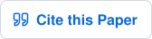

<h1 align="center">MIS-NeRF</h1> 
<h2 align="center">Neural Radiance Fields in Minimally-Invasive Surgery</h2> 

<p align="center"> 
   
</p> 

<p align="center"> 
  <a href="https://github.com/samadbarrikhojasteh/MIS-NeRF"></a> &nbsp; 
  <a href="https://doi.org/10.1007/s11548-025-03429-7"></a> &nbsp; 
  <a href="#-citation"></a> 
</p>


## 📝 About

Minimally-Invasive Surgery (MIS) reduces trauma compared to open surgery but is challenging for endophytic lesion localisation. Augmented Reality (AR) is a promising assistance technology that superimposes a preoperative 3D lesion model onto MIS images. This requires solving the difficult problem of 3D model-to-MIS-image registration. We propose MIS-NeRF, a Neural Radiance Field (NeRF) that provides high-fidelity intraoperative 3D reconstruction, used to bootstrap Iterative Closest Point (ICP) registration.

## 1. 🚀 Installation and Setup the Environment

### 📦 Dependencies

MIS-NeRF is developed upon the Nerfstudio framework and [Nerfacto](https://docs.nerf.studio/nerfology/methods/nerfacto.html), so the requirements and dependencies of Nerfstudio remain applicable to MIS-NeRF.

We developed a modified version `v1.0.0` of Nerfstudio, which can be accessed [here](https://github.com/nerfstudio-project/nerfstudio/releases/tag/v1.0.0).

## 2. 📂 Synthetic Liver Dataset

This repository includes a synthetic liver experiment dataset consisting of RGB images, depth maps, and corresponding masks. The RGB images and depth maps were generated using Blender, while the masks were produced using the Segment Anything Model ([SAM](https://github.com/facebookresearch/segment-anything)).

You can access the dataset [here](Dataset). The camera locations provided by the SfM method are also included in the `output_sfm` folder.

If you wish to use a different dataset, you can process it using the following command:

```bash
ns-process-data images --sfm-tool colmap --data data/YOUR/DATA/PATH/images --output-dir data/YOUR/OUTPUT/PATH/output_sfm
```

If your custom dataset has a `mask` folder, it must be placed at the same directory level as the `images` folder. The SfM method will use the mask folder if it is available. Otherwise, SfM will estimate the foreground and background without masks.

## 3. 🏋️‍♂️ Training

To train the *MIS-NeRF* model, we recommend using the following command:

```bash
# Train model
ns-train nerfacto --pipeline.model.background-color random --pipeline.model.predict-normals True --pipeline.model.camera-optimizer.mode off --data data/YOUR/DATA/PATH --output-dir data/YOUR/OUTPUT/PATH nerfstudio-data
```

## 4. 📊 Evaluation

To evaluate your trained model on the test dataset and compute photometric metrics, run:

```bash
ns-render dataset --load-config YOUR/PATH/config.yml
```

The metrics CSV file can be found in the `renders` folder.

## 📖 Citation

If you find MIS-NeRF useful, please cite our paper.

```bibtex
@article{Khojasteh2025,
  author  = {Samad Barri Khojasteh and David Fuentes-Jimenez and Daniel Pizarro and Yamid Espinel and Adrien Bartoli},
  title   = {MIS-NeRF: neural radiance fields in minimally-invasive surgery},
  journal = {International Journal of Computer Assisted Radiology and Surgery},
  year    = {2025},
  doi     = {10.1007/s11548-025-03429-7},
  url     = {https://doi.org/10.1007/s11548-025-03429-7}
}
```
